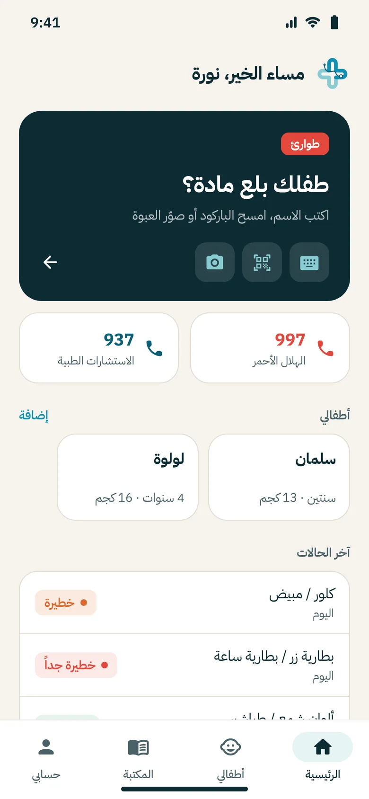
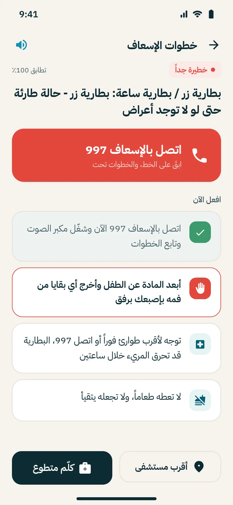
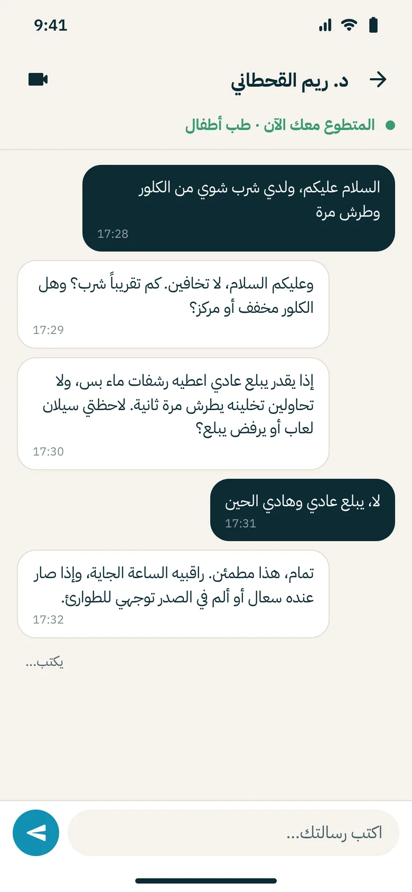
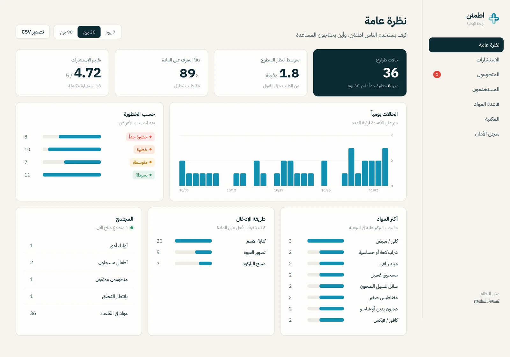

<p align="center">
  
</p>

<h1 align="center">Atma'en · اطمئن</h1>
<p align="center"><b>Smart first aid guide for accidental chemical ingestion in children</b><br>
Graduation project, BSc Information Technology, Jazan University (Aug 2025 – May 2026)</p>

---

When a child swallows bleach, a button battery or a parent's pills, the family usually has a few
minutes before professional help can reach them. Those minutes are often spent panicking, searching
online, or doing something harmful like forcing the child to vomit.

Atma'en gives the parent clear, substance-specific first aid steps in those minutes, and connects them
to a volunteer doctor or medical student when it matters.

| Parent app | Guidance | Volunteer chat | Admin dashboard |
|---|---|---|---|
|  |  |  |  |

## What it does

- **Identify the substance** by typing its name (Arabic or English, typos and brand names included),
  scanning the barcode, or taking a photo.
- **Get first aid steps** in text and audio, adjusted to the child's age and the symptoms they show.
  Critical cases put the 997 call first.
- **Talk to a volunteer**: verified doctors and medical students get cases sorted by severity, see the
  child's age, weight and allergies, and reply by chat or video. Their service hours are logged.
- **Emergency tools**: one-tap 997, nearest hospitals, and an SMS with the child's details and location.
- **Works offline**: protocols, the chemical list and the library are stored on the phone.
- **Prevention library**: short articles on safe storage, choking, burns and bleeding.
- **Admin dashboard**: volunteer verification, the chemical database, consultation monitoring,
  anonymized reports and an audit log.

## Repository

```
backend/   FastAPI + SQLAlchemy API, AI module, tests          -> backend/README.md
mobile/    Flutter app for parents and volunteers (Arabic, RTL) -> mobile/README.md
admin/     React + TypeScript admin dashboard
docs/      project page (GitHub Pages), screenshots, design notes
```

## Quick start

```bash
# API
cd backend
python -m venv .venv && source .venv/bin/activate
pip install -r requirements-dev.txt
cp .env.example .env
python -m scripts.seed --demo
uvicorn app.main:app --reload          # http://localhost:8000/docs

# admin dashboard
cd admin && npm install && npm run dev  # http://localhost:5173

# mobile
cd mobile && flutter create . --platforms=android,ios --org sa.atmaen
flutter pub get && flutter run --dart-define=API_URL=http://10.0.2.2:8000
```

Or everything with MySQL: `docker compose up --build` (admin on :8080, API on :8000).

Demo accounts: `admin@atmaen.sa / Admin@12345`, `parent@demo.sa / Demo@1234`, `volunteer@demo.sa / Demo@1234`.

## Tech

| Layer | Stack |
|---|---|
| Mobile | Flutter, Provider, sqflite, mobile_scanner, flutter_tts, geolocator, web_socket_channel |
| API | Python, FastAPI, SQLAlchemy 2, PyJWT, bcrypt, RapidFuzz |
| AI | Fuzzy text matching with Arabic normalization, EAN-13 validation, MobileNetV2 (TensorFlow) image classifier |
| Data | MySQL (SQLite for local dev and offline on the phone) |
| Admin | React, TypeScript, Vite |

More detail in [docs/architecture.md](docs/architecture.md).

## Medical content

The first aid protocols are written from public poison-centre and first aid guidance and are meant
for the time **before** professional help arrives. They must be reviewed by licensed clinicians before
any real-world use, see [docs/medical-review.md](docs/medical-review.md). In an emergency in Saudi
Arabia, call **997**.

## Team

Supervised by **Dr. Ghufran Babeir**, College of Engineering and Computer Science, Jazan University.
